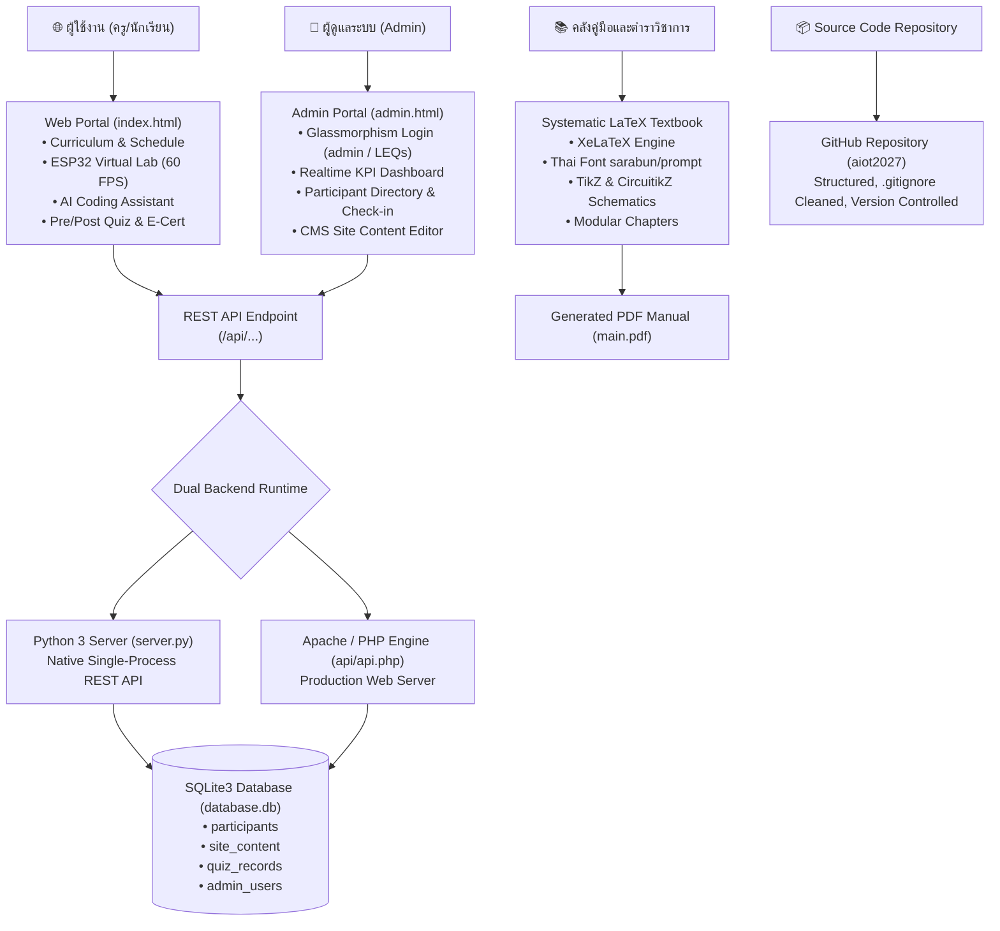

# 🚀 AIoT Fullstack Web, Database, Admin CMS & LaTeX Manual Architect

**AIoT Fullstack & LaTeX Architect** คือกรอบการทำงานระดับมืออาชีพที่รวบรวมมาตรฐานการออกแบบ พัฒนา และเชื่อมโยง 4 องค์ประกอบสำคัญของโครงการนวัตกรรมเทคโนโลยีและการศึกษาดิจิทัล:
1. **Frontend Web Portal**: พอร์ทัลกิจกรรมและคลังความรู้พร้อมแล็บจำลองเสมือนจริง (Virtual Lab) 60 FPS
2. **Dual-Runtime Backend & Database**: ฐานข้อมูล SQLite3 รองรับทั้ง Python HTTP Server และ Apache / XAMPP PHP
3. **Admin Management Portal (CMS)**: ระบบหลังบ้านสไตล์ Glassmorphism บริหารจัดการผู้สมัคร สถิติ เช็คอิน และเนื้อหาเพจ
4. **Systematic LaTeX Textbook & Manual**: ระบบเอกสารคู่มือและตำราวิชาการระดับ Masterclass ด้วย XeLaTeX และ CircuitikZ

---

## 🏛️ สถาปัตยกรรมระบบโดยรวม (System Overview)



---

## 💻 1. มาตรฐานการพัฒนา Frontend Web Portal

### 1.1 โครงสร้างโฟลเดอร์มาตรฐาน
```text
project_root/
├── index.html          # หน้าหลักพอร์ทัล (Single-Page Application Tabs)
├── admin.html          # ระบบจัดการหลังบ้าน (Admin Portal)
├── style.css           # Vanilla CSS Design System (Dark Space Theme)
├── app.js              # Vanilla JavaScript ควบคุม UI, Charts, Canvas, State
├── server.py           # Python 3 Backend + SQLite3 Native API
├── database.db         # ฐานข้อมูล SQLite3
├── api/
│   └── api.php         # Mirror PHP Backend สำหรับ Apache/XAMPP
└── assets/             # รูปภาพ, ไอคอน, สื่อประกอบ
```

### 1.2 การออกแบบส่วนติดต่อผู้ใช้ (Design System)
* **ชุดสี Dark Space Neon**:
  * Background: `#080d1a` และ `#0f172a`
  * Primary Emerald: `#10b981` (ความสำเร็จ/เกษตรอัจฉริยะ)
  * Secondary Cyan: `#38bdf8` (เทคโนโลยี/คลาวด์)
  * Accent Amber/Orange: `#f97316` (ระบบแจ้งเตือน/ฮาร์ดแวร์)
  * Glass Surface: `rgba(15, 23, 42, 0.75)` พร้อม `backdrop-filter: blur(16px)`
* **โมเดลฟุตเตอร์ 4 คอลัมน์ (ถอดแบบจาก `scirbru_praneet2026`)**:
  * คอลัมน์ 1: Brand Logo, ข้อมูลองค์กร และวิสัยทัศน์โครงการ
  * คอลัมน์ 2: เมนูหลัก (หน้าหลัก, ลงทะเบียน, รายชื่อ, AI Coding, Virtual Lab, เกียรติบัตร, Admin)
  * คอลัมน์ 3: ช่องทางติดต่อ (คณะ, มหาวิทยาลัย, เบอร์โทร, อีเมล, เว็บไซต์อาจารย์ผู้ประสานงาน)
  * คอลัมน์ 4: พิกัดศูนย์การเรียนรู้ (Google Maps Embed + ข้อมูลพิกัดและระบบตรวจวัด)
  * Sub-footer: แถบระบุลิขสิทธิ์ความร่วมมือ (Partners)
  * Mobile Bottom Nav: แถบนำทางด้านล่างแบบ Sticky สำหรับสมาร์ทโฟน (ดูรายละเอียดและโค้ดต้นแบบในหัวข้อ 1.3)

### 1.3 สถาปัตยกรรมแถบเมนูบาร์สมาร์ทโฟน 3 มิติ (3D Curved Scoop Dock & Tactile 3D Icons)

แถบนำทางด้านล่าง (Bottom Navigation Bar) สำหรับมุมมองมือถือ ถือเป็นจุดสัมผัสหลัก (Primary Touchpoint) ของผู้ใช้ การออกแบบต้องผสานทั้งความสวยงามเชิงมิติ 3 มิติ (Aesthetics) และความเสถียรไร้บั๊ก (Robustness):

#### กฎเหล็กและข้อควรระวังในการสร้าง Mobile Bottom Nav:
1. **Zero Content Bleed-Through Rule (ห้ามเนื้อหาหน้าเว็บทะลุรอยเว้า):**
   * *ปัญหาคลาสสิก:* การใช้ SVG Path เจาะรูเว้า (Transparent Cutout) ตรงกลาง จะทำให้ข้อความ รูปภาพ หรือการ์ดบนหน้าเว็บเวลาเลื่อน (Scroll) ทะลุขึ้นมาเห็นใต้ปุ่ม FAB และตัวอักษรเมนู
   * *วิธีแก้มาตรฐาน:* ต้องวาง **Solid Base Shield (พื้นหลังขาวทึบ 100%)** รองรับด้านหลังเสมอ และใช้ **Molded Concave Dish (หลุมเว้า 3 มิติพร้อม Radial Shading)** เติมเต็มใต้รอยเว้า เพื่อให้เนื้อหาหน้าเว็บมุดลงด้านหลังอย่างหมดจด 100%
2. **Unclipped Floating Action Button (ห้ามปุ่มลอยถูกตัดขอบ):**
   * คอนเทนเนอร์หลัก `<nav>` ต้องใช้ `overflow-visible` เสมอ (ห้ามใช้ `overflow-hidden` เด็ดขาด เพราะจะตัดเฉือนส่วนบนของปุ่มกลมที่ลอยพ้นขอบบน)
   * การป้องกันการล้นขอบจอแนวนอน ให้ควบคุมด้วย `w-full max-w-[100vw]` ร่วมกับ `max-w-md mx-auto` ในแถวไอคอน
3. **โครงสร้างรอยเว้าโค้ง 3 มิติ (3D Curved Scoop Geometry):**
   * ใช้ SVG `viewBox="0 0 375 90"` พร้อมเส้น Bezier Curve ที่นุ่มนวล:
     `M0,12 L134,12 C146,12 153,46 187.5,46 C222,46 229,12 241,12 L375,12 L375,90 L0,90 Z`
   * ตกแต่งขอบบนด้วย **Rim Stroke Gradient** เลียนแบบแสงสะท้อนขอบโลหะ/กระจก และ **Inner Scoop Shadow** เสริมมิติความลึก
4. **ชุดไอคอน 3 มิติสัมผัสจริง (Vibrant 3D Tactile Icons System):**
   * **โครงสร้าง Claymorphic Squircle:** กรอบสี่เหลี่ยมมน `rounded-2xl` ซ้อนเลเยอร์ 3D Gradient พร้อมแถบแสงสะท้อนด้านบน `bg-gradient-to-b from-white/70 to-transparent` (Specular Highlight)
   * **การจับคู่สีบอกฟังก์ชัน (Color Hierarchy):**
     * 🟢 **หน้าหลัก (Home):** Emerald/Teal 3D Orb (`from-emerald-400 to-teal-700`)
     * 🟠 **โมดูล/คอร์ส (Modules):** Amber/Orange 3D Orb (`from-amber-400 to-rose-600`) พร้อมลูกแก้วแจ้งเตือนกระพริบ (Pulsing Orb)
     * 💎 **ปุ่มหลักกลาง (Center FAB):** อัญมณี 3 มิติขนาดใหญ่ (58px) พร้อมขอบแหวนนูน Bevel Ring ซ้อนป้ายแคปซูล 3 มิติด้านล่าง
     * 🔵 **รายชื่อ (Participants):** Sky/Blue/Indigo 3D Orb (`from-cyan-400 to-indigo-700`)
     * 🟣 **แดชบอร์ด (Analytics):** Purple/Fuchsia 3D Orb (`from-fuchsia-400 to-indigo-700`)
   * **Tactile Feedback:** เพิ่มแอนิเมชันยุบตัว 3 มิติเสมือนปุ่มจริงเมื่อกด (`active:scale-90 transition-transform`)
5. **การรองรับ Safe-Area Inset (iPhone / Android Gestures):**
   * กำหนดสไตล์ `style="padding-bottom: max(env(safe-area-inset-bottom, 0px), 6px);"` เพื่อป้องกันไม่ให้เมนูชนกับแถบโฮมของ iOS หรือแถบนำทาง Android

#### โค้ดคอมโพเนนต์ต้นแบบพร้อมใช้งาน (`includes/bottom_nav.php`):
```html
<nav id="mobileBottomNav" class="md:hidden fixed bottom-0 left-0 right-0 z-50 pointer-events-auto select-none w-full max-w-[100vw] overflow-visible" style="padding-bottom: max(env(safe-area-inset-bottom, 0px), 6px);">
    <!-- 3D Curved Scoop Background with Molded Recessed Dish -->
    <div class="absolute bottom-0 inset-x-0 w-full h-[78px] pointer-events-none">
        <div class="absolute inset-0 bg-white shadow-[0_-10px_35px_rgba(0,0,0,0.08)]"></div>
        <svg class="absolute -top-3 w-full h-[90px] filter drop-shadow-[0_-6px_16px_rgba(0,0,0,0.06)]" viewBox="0 0 375 90" preserveAspectRatio="none">
            <defs>
                <linearGradient id="barGradient3D" x1="0%" y1="0%" x2="0%" y2="100%">
                    <stop offset="0%" stop-color="#ffffff" /><stop offset="100%" stop-color="#f8fafc" />
                </linearGradient>
                <radialGradient id="scoopDish3D" cx="50%" cy="30%" r="65%">
                    <stop offset="0%" stop-color="#f1f5f9" stop-opacity="0.9" />
                    <stop offset="100%" stop-color="#cbd5e1" stop-opacity="0.3" />
                </radialGradient>
            </defs>
            <ellipse cx="187.5" cy="20" rx="42" ry="20" fill="url(#scoopDish3D)" />
            <path d="M0,12 L134,12 C146,12 153,46 187.5,46 C222,46 229,12 241,12 L375,12 L375,90 L0,90 Z" fill="url(#barGradient3D)" stroke="#cbd5e1" stroke-width="1.2" />
        </svg>
    </div>

    <!-- Navigation Items Grid -->
    <div class="relative flex justify-between items-end px-2 sm:px-5 h-[76px] w-full max-w-md mx-auto z-20 pb-2">
        <!-- 3D Tab 1: หน้าหลัก -->
        <a href="index.php" class="flex flex-col items-center justify-center w-14 group active:scale-90">
            <div class="w-10 h-10 rounded-2xl bg-gradient-to-br from-emerald-400 via-emerald-500 to-teal-700 p-0.5 shadow-[0_4px_12px_rgba(16,185,129,0.38)] border border-emerald-300/40 relative overflow-hidden flex items-center justify-center">
                <div class="absolute inset-x-1 top-0.5 h-3 bg-gradient-to-b from-white/70 to-transparent rounded-t-xl"></div>
                <i class="fa-solid fa-house text-white text-base drop-shadow"></i>
            </div>
            <span class="text-[10px] font-bold text-emerald-800 mt-1">หน้าหลัก</span>
        </a>

        <!-- Center 3D Floating Action Button: ลงทะเบียน -->
        <div class="relative flex flex-col items-center justify-center -top-3 z-30">
            <a href="register.php" class="group relative flex items-center justify-center rounded-full p-1 bg-gradient-to-b from-white via-slate-100 to-slate-200 shadow-[0_10px_25px_rgba(16,185,129,0.45)] border border-white hover:scale-105 active:scale-90 w-[58px] h-[58px]">
                <div class="w-full h-full rounded-full bg-gradient-to-tr from-emerald-600 via-teal-500 to-cyan-400 shadow-inner flex items-center justify-center relative overflow-hidden">
                    <div class="absolute top-1 left-2 w-5 h-2.5 bg-white/70 rounded-full blur-[0.6px]"></div>
                    <i class="fa-solid fa-user-plus text-2xl text-white drop-shadow"></i>
                </div>
            </a>
            <span class="px-2.5 py-0.5 rounded-full bg-gradient-to-r from-emerald-700 to-teal-700 text-white text-[10px] font-bold shadow mt-1">ลงทะเบียน</span>
        </div>
    </div>
</nav>
```

---

## 🗄️ 2. ระบบฐานข้อมูล SQLite3 & Dual-Backend

### 2.1 โครงสร้างตาราง (Database Schema)
```sql
-- 1. ตารางผู้สมัครเข้าร่วมอบรม
CREATE TABLE IF NOT EXISTS participants (
    id INTEGER PRIMARY KEY AUTOINCREMENT,
    reg_code TEXT UNIQUE,
    prefix TEXT,
    fullname TEXT NOT NULL,
    role TEXT DEFAULT 'student',
    school TEXT NOT NULL,
    grade_dept TEXT,
    phone TEXT,
    email TEXT,
    food_pref TEXT DEFAULT 'normal',
    status TEXT DEFAULT 'confirmed',
    checked_in INTEGER DEFAULT 0,
    created_at TIMESTAMP DEFAULT CURRENT_TIMESTAMP
);

-- 2. ตารางเนื้อหาเว็บไซต์แบบไดนามิก (CMS)
CREATE TABLE IF NOT EXISTS site_content (
    key TEXT PRIMARY KEY,
    value TEXT
);

-- 3. ตารางบันทึกผลคะแนนแบบทดสอบ (Pre-test / Post-test)
CREATE TABLE IF NOT EXISTS quiz_records (
    id INTEGER PRIMARY KEY AUTOINCREMENT,
    fullname TEXT NOT NULL,
    school TEXT,
    quiz_type TEXT NOT NULL,
    score INTEGER NOT NULL,
    total_questions INTEGER NOT NULL,
    answers_json TEXT,
    created_at TIMESTAMP DEFAULT CURRENT_TIMESTAMP
);

-- 4. ตารางผู้ดูแลระบบ (Admin Authentication)
CREATE TABLE IF NOT EXISTS admin_users (
    username TEXT PRIMARY KEY,
    password TEXT NOT NULL
);
```

### 2.2 มาตรฐานความปลอดภัยของ Admin Credentials
* บัญชีเริ่มต้นมาตรฐาน: **Username: `admin`** / **Password: `LEQs`**
* บันทึกแบบ Seed ตรวจสอบรหัสผ่านที่ตรงกันทั้งบน `server.py` และ `api/api.php`
* การตอบกลับ Token ชั่วคราวใน `sessionStorage` เพื่อป้องกันการเข้าถึงหน้าแดชบอร์ดโดยไม่ผ่านการยืนยันตัวตน

---

## 🔐 3. ระบบหลังบ้าน Admin Portal (ถอดแบบจาก `globe2026/admin_login.php`)

### 3.1 การ์ดล็อกอินสไตล์ Glassmorphism
* การ์ดโปร่งแสงพื้นขาวนวล `rgba(255, 255, 255, 0.96)` บนพื้นหลัง Deep Dark Space
* แถบแสงไล่ระดับ Gradient ด้านบนสุดของการ์ด
* วงกลมไอคอน Shield Avatar พร้อมแอนิเมชันกระจายแสง (Ping Animation)
* ช่อง Input พร้อมไอคอนกำกับด้านซ้าย (`fas fa-user`, `fas fa-lock`)
* ปุ่มสลับดู/ซ่อนรหัสผ่าน (Show/Hide Eye Toggle)
* ปุ่มส่งฟอร์มไล่สี Gradient พร้อมไอคอนลูกศร
* ลิงก์ **"← กลับสำหรับหน้าหลัก"** เชื่อมโยงกลับสู่หน้าแรก

### 3.2 แดชบอร์ดผู้ดูแลระบบ (Admin Console)
1. **📊 สถิติภาพรวม (Real-time KPIs)**:
   * ยอดผู้สมัครรวมเทียบความจุ (เช่น 60 ที่นั่ง)
   * สัดส่วนคุณครู vs นักเรียน
   * จำนวนสถานศึกษาที่เข้าร่วม
   * ยอดผู้เช็คอินหน้างานจริง
2. **👥 รายชื่อผู้สมัคร (Directory & Actions)**:
   * ค้นหาแบบเรียลไทม์ (Live Search) ตามชื่อ โรงเรียน หรือรหัสสมัคร
   * กรองตามประเภท (ครู/นักเรียน) และสถานะเช็คอิน
   * ปุ่มสลับสถานะเช็คอิน (Toggle Check-in) 1 คลิก
   * ปุ่มส่งออกรายชื่อเป็นไฟล์ **CSV** สำหรับเปิดใน Microsoft Excel
   * Modal เพิ่มรายชื่อผู้สมัครด้วยตนเอง (Manual Add)
   * ปุ่มลบข้อมูลพร้อมระบบยืนยัน (Confirmation Dialog)
3. **✍️ ระบบแก้ไขเนื้อหาเพจ (Dynamic CMS)**:
   * แก้ไขข้อความประกาศด่วน (Announcement Banner)
   * ปรับแก้ Hero Title, Subtitle, กำหนดการ และสถานที่จัดงาน
   * บันทึกข้อมูลลงฐานข้อมูล SQLite3 ทันทีโดยไม่ต้องแก้ไฟล์โค้ด HTML
4. **📝 ผลคะแนนแบบทดสอบ (Quiz Analytics)**:
   * แสดงคะแนน Pre-test และ Post-test ของผู้เข้าอบรมแต่ละท่านแบบเรียลไทม์

---

## 📚 4. สถาปัตยกรรมตำราและคู่มือวิชาการ LaTeX (LaTeX Manual Architect)

### 4.1 โครงสร้างโฟลเดอร์เอกสารตำรามาตรฐาน
```text
latex_textbook/
├── main.tex                 # รูทไฟล์หลักที่รวมบทและคำสั่งตั้งค่า
├── styles/
│   ├── preamble.tex         # ฟอนต์ Sarabun/Prompt, ขอบกระดาษ, สี, Hyperref
│   └── tcolorbox_styles.tex # กล่องเน้นข้อความ โค้ดตัวอย่าง นิยาม ทฤษฎี
├── frontmatter/
│   ├── cover.tex            # หน้าปก
│   ├── preface.tex          # คำนำ
│   └── toc.tex              # สารบัญและสารบัญรูปภาพ
├── chapters/
│   ├── ch01_aiot_overview.tex
│   ├── ch02_esp32_firmware.tex
│   ├── ch03_sensors_calibration.tex
│   ├── ch04_deep_learning_edge.tex
│   └── ch05_farm_dashboard.tex
├── figures/                 # แผนภาพเวกเตอร์ TikZ และ CircuitikZ
├── images/                  # รูปภาพคมชัดสูง (PNG/JPG)
└── backmatter/
    ├── references.bib       # แหล่งอ้างอิงทางวิชาการ (BibTeX)
    └── index.tex            # ดรรชนีคำศัพท์
```

### 4.2 การตั้งค่าภาษาไทยและฟอนต์มาตรฐาน (XeLaTeX Preamble)
```latex
\documentclass[11pt,a4paper,oneside]{book}
\usepackage{fontspec}
\usepackage{xunicode}
\usepackage{xltxtra}

% ตั้งค่าฟอนต์ภาษาไทยมาตรฐาน
\defaultfontfeatures{Mapping=tex-text}
\setmainfont{TH Sarabun New}
\newfontfamily\thaifont{TH Sarabun New}
\newfontfamily\codefont{JetBrains Mono}

% ตั้งค่าระยะขอบกระดาษตามมาตรฐานวิชาการ
\usepackage[top=2.54cm, bottom=2.54cm, left=3.81cm, right=2.54cm]{geometry}

% แพ็กเกจสำหรับวงจรอิเล็กทรอนิกส์และแผนภาพ
\usepackage{tikz}
\usepackage[siunitx]{circuitikz}
\usepackage{tcolorbox}
\tcbuselibrary{skins,breakable,listings}
```

### 4.3 สคริปต์คอมไพล์อัตโนมัติ (`build.sh`)
```bash
#!/bin/bash
echo "=== Building LaTeX Textbook with XeLaTeX ==="
xelatex -interaction=nonstopmode main.tex
makeindex main.idx
xelatex -interaction=nonstopmode main.tex
echo "=== PDF Build Complete: main.pdf ==="
```

---

## 🐙 5. การจัดเก็บและจัดการบน GitHub (Git Workflow)

### 5.1 ไฟล์ `.gitignore` มาตรฐานสำหรับโปรเจกต์ AIoT + LaTeX
```gitignore
# Python & Virtual Environments
__pycache__/
*.py[cod]
*$py.class
.venv/
env/

# Large Media Files (Over 100MB)
*.mp4
*.mov
*.avi
*.mkv

# LaTeX Build Artifacts
*.aux
*.log
*.toc
*.lof
*.lot
*.out
*.idx
*.ilg
*.ind
*.listing

# OS & IDE
.DS_Store
Thumbs.db
.vscode/
.idea/
```

### 5.2 ขั้นตอนการ Push ขึ้น GitHub
```bash
git init
git add README.md .gitignore scirbru_ydai2026/ latex_textbook/
git commit -m "feat: complete AIoT web portal, admin CMS, SQLite3 database, and LaTeX textbook"
git branch -M main
git remote add origin https://github.com/Tsanaphy2023/aiot2027.git
git push -u origin main
```
