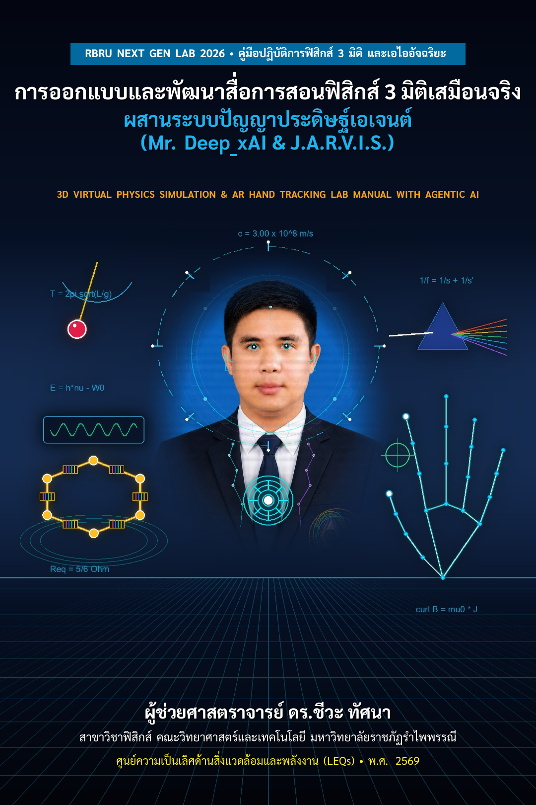

# physics_3d_simulation_lab
# RBRU NextGen Virtual Physics Lab & AI Ecosystem (2026)

<p align="center">
  
</p>

<p align="center">
  <b>📖 ตำราและคู่มือปฏิบัติการฉบับสมบูรณ์ (54 หน้า):</b> <a href="workshop_manual_3d_ar_ai/main.pdf"><b>workshop_manual_3d_ar_ai/main.pdf</b></a><br>
  <i>มาตรฐาน Academic Book Cover Architect (สัดส่วน 2:3, Full-Bleed 6x9 นิ้ว, XeLaTeX TikZ Transparent Architecture)</i>
</p>

ระบบห้องปฏิบัติการฟิสิกส์ 3 มิติเสมือนจริง และผู้ช่วยอัจฉริยะ Co-creation Real-Time Multimodal AI (Mr. Deep_xAI — หนุ่มสุโขทัย สไตล์ Jarvis) ครบครัน 16 ปฏิบัติการใน 7 กลุ่มสาขาวิชาฟิสิกส์ รองรับการปฏิสัมพันธ์แบบ Three.js PBR Shaders, การตรวจจับท่าทางมือไร้สัมผัส AR MediaPipe Hands, การสแกนภาพฉาก 3D Real-time และการตอบสนองด้วยเสียงสำเนียงสุโขทัยแท้ๆ พร้อม KaTeX เวกเตอร์คมชัด 100%

---

## 📁 โครงสร้างโปรเจกต์ (Modular File Structure)

โค้ดได้รับการจัดหมวดหมู่แยกไฟล์อย่างเป็นระบบ เพื่อให้ง่ายต่อการพัฒนา บำรุงรักษา และต่อยอดฟีเจอร์ใหม่:

```text
nextgen_lab2026/
├── index.html                   # ไฟล์หลัก (Entry Point) รวม HTML Semantic & โครงสร้างเลย์เอาต์
├── README.md                    # เอกสารอธิบายโครงสร้างระบบและคู่มือการพัฒนา
│
├── css/                         # โมดูลสไตล์ชีท (Modular Stylesheets)
│   ├── main.css                 # ตัวแปรสี (CSS Variables), Reset, Layout & Topbar Navigation
│   ├── panels.css               # แผงควบคุมด้านข้าง (Sidebars), ปุ่มกด, ตารางข้อมูล & สไลเดอร์
│   ├── meters.css               # หน้าปัดมิเตอร์อนาล็อกและดิจิทัล (Volt & Amp Gauges)
│   ├── ar.css                   # กล่องแสดงผลกล้อง AR, ป้ายท่าทางมือ & เคอร์เซอร์เสมือน
│   └── modal.css                # หน้าต่างป๊อปอัปเฉลยโจทย์และหลักการคำนวณ (Solution Modal)
│
└── js/                          # โมดูลจาวาสคริปต์ (Modular Logic & Physics Engine)
    ├── state.js                 # ตัวแปรสถานะส่วนกลาง, ค่าคงที่วงจร, ข้อมูลลูกตุ้ม & สูตรคำนวณฟิสิกส์
    ├── scene.js                 # การตั้งค่า Three.js (Scene, Camera, Renderer, แสงเงา & ฟังก์ชันสร้างวัตถุ 3D)
    ├── exp1-circuit.js          # กิจกรรมที่ 1: แผงวงจร 6 เหลี่ยม, แหล่งจ่ายไฟ DC, สวิตช์, มิเตอร์ & สายไฟ
    ├── exp2-pendulum.js         # กิจกรรมที่ 2: ขาตั้ง Retort, ไม้บรรทัดเมตร, แผ่นวัดมุม & ลูกตุ้มเพนดูลัม
    ├── labels-raycaster.js      # ป้ายชื่อลอย 3D (Floating Labels) และระบบคลิกขั้วต่อด้วย Raycaster
    ├── ui-exp1.js               # ตัวควบคุมหน้าจอ UI กิจกรรมที่ 1 (สลับเข็ม/ดิจิทัล, บันทึกตาราง, สวิตช์)
    ├── ui-exp2.js               # ตัวควบคุมหน้าจอ UI กิจกรรมที่ 2 (ความยาวเชือก, นาฬิกาจับเวลา, พล็อตเตอกราฟ)
    ├── ar-mediapipe.js          # ระบบตรวจจับมือ AR MediaPipe (จีบนิ้ว Pinch, กำมือ Orbit, ชู 2 นิ้ว)
    └── app.js                   # บูตสแตรปแอปพลิเคชัน, Loop เรนเดอร์ 60 FPS, ฟิสิกส์สปริงเข็มมิเตอร์ & รีไซส์
```

---

## 🚀 วิธีการเปิดใช้งาน (How to Run)

โปรเจกต์นี้เขียนด้วย Vanilla HTML, CSS และ JavaScript โดยไม่จำเป็นต้องติดตั้ง Node.js หรือผ่านกระบวนการ Build:

1. **เปิดตรงผ่านเบราว์เซอร์ (Direct Launch):**
   - ดับเบิลคลิกเปิดไฟล์ `index.html` บนเบราว์เซอร์ (Chrome, Edge, Safari, Firefox) ได้ทันที
2. **เปิดผ่าน Local HTTP Server (แนะนำสำหรับใช้งานกล้องเว็บแคม AR):**
   ```bash
   # ใช้ Python
   python3 -m http.server 8080
   
   # หรือใช้ npx serve
   npx serve .
   ```
   จากนั้นเปิดเบราว์เซอร์ไปที่ `http://localhost:8080`

---

## 🛠️ รายละเอียดการทำงานของแต่ละโมดูล

### 1. การจัดการสไตล์ (`css/`)
- **`main.css`**: จัดการธีม Dark Mode, ตัวแปรสีระดับห้องปฏิบัติการ (เช่น `--bg-dark`, `--accent-cyan`), โครงสร้างแถบด้านบน (Top Navigation), แท็บสลับการทดลอง และปุ่มควบคุมกล้อง
- **`panels.css`**: ดีไซน์กล่องควบคุม Glassmorphism, ตารางบันทึกผลการทดลองที่มีการไฮไลต์แถวค่าสูงสุดอัตโนมัติ, สไลเดอร์ปรับค่า, ป้ายแสดงผลสูตรคำนวณ และป้ายชื่อ 3D ลอยตัว (`.label-3d`)
- **`meters.css`**: คอนโทรลหน้าปัดโวลต์มิเตอร์และแอมมิเตอร์ ทั้งแบบแสดงผลตัวเลขทศนิยม/เศษส่วนแท้ และแบบวาดแคนวาสจำลองหน้าปัดกระจก
- **`ar.css`**: แถบควบคุม MediaPipe ด้านล่าง มีกรอบแสดงภาพกล้องมุมมองตนเอง, ป้ายสถานะ AI และเคอร์เซอร์เป้าเล็งมือเสมือนที่ตอบสนองเมื่อจีบนิ้ว (Pinch) หรือกำมือ (Fist)
- **`modal.css`**: หน้าต่างเฉลยละเอียด จัดรูปแบบสมการคณิตศาสตร์ KaTeX และหน้าต่างศูนย์รวม 7 กลุ่มวิชา (Hub Modal)
- **`experiments-registry.js`**: ตัวจัดการ Registry สถาปัตยกรรม 7 กลุ่มวิชาฟิสิกส์พื้นฐาน จัดการ Lifecycle (`init`, `activate`, `deactivate`, `update`, `mountUI`), Dynamic Side Panels, และกล้อง 3D

### 2. โครงสร้างโมดูลาร์ 7 กลุ่มวิชา (7-Domain Physics Curriculum Architecture)
ระบบถูกออกแบบตามสถาปัตยกรรม Plug & Play ยืดหยุ่นสูงสุดเพื่อรองรับปฏิบัติการฟิสิกส์พื้นฐานทั้งหมด:
1. **⚡ ไฟฟ้าและวงจร (Electricity & Circuits):**
   - `elec_hex_loop`: วงจรโครงข่ายตัวต้านทาน 6 เหลี่ยม (IJSO Hexagonal Circuit)
   - `elec_wheatstone`: วงจรบริดจ์ของวีตสตัน (Wheatstone Slide-Wire Bridge) พร้อมกัลวาโนมิเตอร์สมดุลศูนย์
2. **🧲 แม่เหล็กไฟฟ้า (Electromagnetism & Induction):**
   - `em_faraday_lenz`: การเหนี่ยวนำแม่เหล็กไฟฟ้าตามกฎของฟาราเดย์และเลนซ์
   - `em_solenoid_field`: สนามแม่เหล็กในขดลวดโซเลนอยด์
3. **⚙️ กลศาสตร์และการเคลื่อนที่ (Mechanics & Dynamics):**
   - `mech_pendulum`: การแกว่งของลูกตุ้มเพนดูลัมอย่างง่ายและการวัดค่า g
   - `mech_air_track`: การอนุรักษ์โมเมนตัมและการชนในหนึ่งมิติบนรางลม
   - `mech_free_fall`: การตกอิสระและโฟโตเกต
4. **🌊 คลื่นและเสียง (Waves & Acoustics):**
   - `waves_resonance`: การสั่นพ้องในหลอดเรโซแนนซ์และความเร็วเสียง พร้อม Web Audio API Synth & Oscilloscope
   - `waves_standing_string`: คลื่นนิ่งในเส้นเชือก
5. **💡 ทัศนศาสตร์และแสง (Optics & Wave Optics):**
   - `optics_bench`: รางทัศนศาสตร์ เลนส์บาง การเกิดภาพ และ 3D Ray Tracing พร้อม Auto Focus
   - `optics_diffraction`: การแทรกสอดสลิตคู่และการเลี้ยวเบนผ่านเกรตติง
6. **🌡️ อุณหพลศาสตร์และสสาร (Thermodynamics & Matter):**
   - `thermo_ideal_gas`: กฎของแก๊สอุดมคติและการหาศูนย์สัมบูรณ์
   - `thermo_calorimeter`: แคลอริมิเตอร์และความร้อนจำเพาะ
7. **⚛️ ฟิสิกส์ยุคใหม่และควอนตัม (Modern & Quantum Physics):**
   - `modern_photoelectric`: ปรากฏการณ์โฟโตอิเล็กทริกและค่าคงตัวของพลังค์ h
   - `modern_half_life`: การสลายตัวของสารกัมมันตรังสีและครึ่งชีวิต

---

## 🛠️ วิธีการเพิ่มปฏิบัติการใหม่ (Plug & Play Lab Development)

การเพิ่มการทดลองใหม่ทำได้สะดวกและยืดหยุ่น โดยไม่ต้องแก้ไขโค้ดโครงสร้างหลักเดิม:
1. สร้างไฟล์ใหม่ใน `js/experiments/your-lab.js`
2. ลงทะเบียนเข้าสู่ระบบผ่าน `PhysicsLabRegistry.registerExperiment({...})`:

```javascript
PhysicsLabRegistry.registerExperiment({
  id: 'my_new_lab',
  domainId: 'optics', // 1 ใน 7 กลุ่ม: electricity, electromagnetism, mechanics, waves, optics, thermo, modern
  title: 'ชื่อการทดลองเต็ม',
  shortTitle: '💡 ชื่อย่อบนแท็บ',
  description: 'คำอธิบายและวัตถุประสงค์เชิงพฤติกรรม OBE',
  keyFormula: '$$\\frac{1}{f} = \\frac{1}{s} + \\frac{1}{s\'}$$',
  camera: { position: [0, 6, 8], target: [0, 1, 0] },
  status: 'active',

  init(scene) {
    this.group = new THREE.Group();
    // สร้างอุปกรณ์ 3D และเพิ่มเข้า this.group
    scene.add(this.group);
  },
  update(dt, now) {
    // คำนวณฟิสิกส์แอนิเมชัน 60 FPS
  },
  getLeftPanelHTML() {
    return `<div class="section-card">...สไลเดอร์และปุ่มควบคุม...</div>`;
  },
  getRightPanelHTML() {
    return `<div class="section-card">...ตารางและกราฟวิเคราะห์ผล...</div>`;
  },
---

## 📚 ตำราและคู่มือเชิงปฏิบัติการ (Workshop Manual XeLaTeX)

โฟลเดอร์ `workshop_manual_3d_ar_ai/` บรรจุเอกสารทางวิชาการและคู่มือการอบรมเชิงปฏิบัติการฉบับสมบูรณ์ ออกแบบตามข้อกำหนดการขอตำแหน่งทางวิชาการ มหาวิทยาลัยราชภัฏรำไพพรรณี:
- **รูปแบบเล่ม:** พิมพ์ 6x9 นิ้ว (152.4 x 228.6 มม.), ฟอนต์ TH Sarabun New, กั้นหน้าซ้าย 1.5 นิ้ว หน้าขวา 1 นิ้ว
- **ปกหนังสือ 3D ล้ำอนาคต:** ผลงาน 3D Hologram Art สัดส่วน 2:3 พร้อมเทคนิค Dual-Layer Micro Drop-Shadow และเวกเตอร์ TikZ Dark-Mode Inner Cover
- **เนื้อหา 6 บทหลัก (รวม 54 หน้า):**
  1. ภาพรวมและหลักการออกแบบระบบจำลองฟิสิกส์ 3 มิติ (พร้อมสถาปัตยกรรม 7 กลุ่มวิชา)
  2. การสร้างและจัดการเนื้อหาฟิสิกส์ด้วย AI (พร้อมเจาะลึก Agentic AI Bot Mr. Deep_xAI & J.A.R.V.I.S.)
  3. เทคนิค Three.js และการปฏิสัมพันธ์แบบสมจริง (PBR Shaders & Dynamic Lighting)
  4. ระบบติดตามมือด้วย AR MediaPipe Hands (Zero-GC Loop & 21-Joint Cyber Skeleton)
  5. การทดสอบ การดีบั๊ก และการแก้ปัญหาประสิทธิภาพ (Web Workers & 60 FPS Profiling)
  6. การประเมินผลและการประยุกต์ใช้ในชั้นเรียน (Hake's Normalized Learning Gain $\langle g \rangle$)

### คำสั่งคอมไพล์เอกสาร (XeLaTeX):
```bash
cd workshop_manual_3d_ar_ai
/Library/TeX/texbin/xelatex -interaction=nonstopmode main.tex
```
ไฟล์ผลลัพธ์จะถูกสร้างเป็น `main.pdf` พร้อมใช้งานทันที


